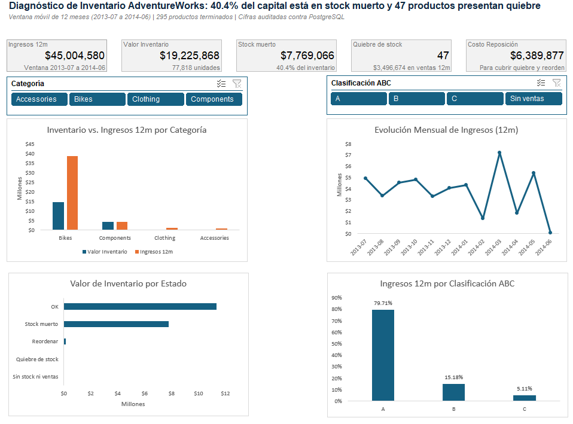
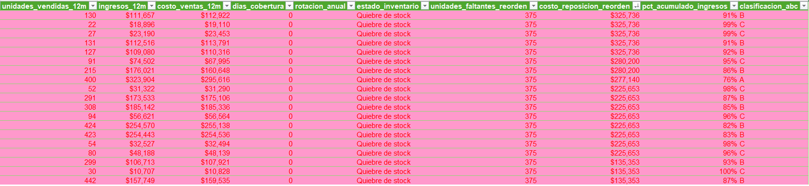
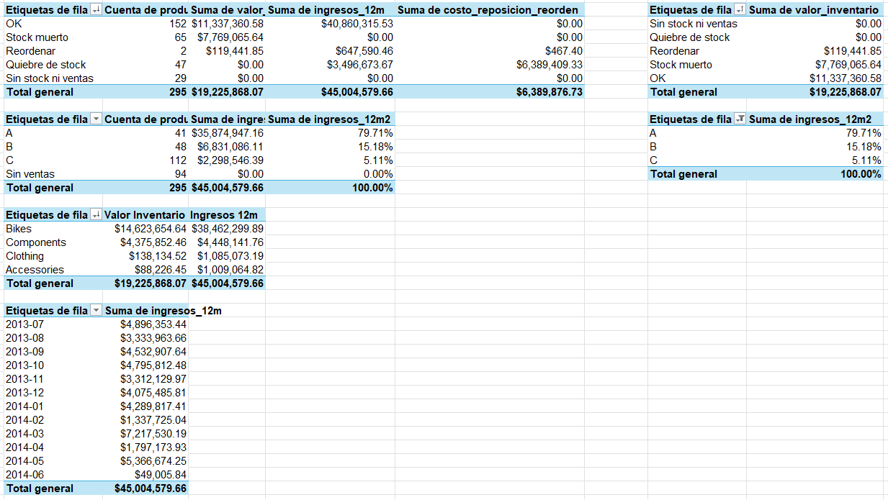

# Diagnóstico de Inventario AdventureWorks: el 40.4% del capital está en stock muerto mientras 47 productos presentan quiebre

Análisis operativo de inventario, cobertura, rotación, punto de reorden y clasificación ABC sobre el dataset **AdventureWorks** (Microsoft), integrando modelado y auditoría en **PostgreSQL 18** con un tablero operativo interactivo en **Microsoft Excel**.

**Stack:** PostgreSQL 18 · SQL · Microsoft Excel (Power Query, tablas estructuradas, `SUMIFS`/`XLOOKUP`/`IFS`, tablas y gráficos dinámicos, slicers)  
**Rol objetivo:** Junior Data Analyst · Operations Data Analyst · BI Analyst  
**Alcance analítico:** Ventana móvil comparable de 12 meses (`2013-07` a `2014-06`) · `295` productos terminados · `1,732` registros mensuales · **100% auditado contra SQL (0 diferencias fila a fila)**

---

## El problema de negocio

Mantener exceso de inventario inmoviliza capital de trabajo y ocupa almacén; quedarse sin stock frena la facturación y deteriora el nivel de servicio. El objetivo de este proyecto es responder **qué productos están en riesgo de quiebre, cuánto capital está inmovilizado y cuánto cuesta reponer el almacén**, separando dos métricas que suelen confundirse:

- **Cobertura (días):** para cuántos días alcanza el stock actual al ritmo de venta diaria de los últimos 12 meses (*foto de hoy*).
- **Rotación anual (veces):** cuántas veces se vendió y repuso el inventario en el periodo (`costo de ventas 12m / valor de inventario`).

---

## Resumen ejecutivo (KPIs auditados)

Todas las cifras provienen del modelo SQL ([`03_modeling/01_crear_modelo_inventario.sql`](03_modeling/01_crear_modelo_inventario.sql)) y fueron conciliadas al centavo contra el libro de Excel en [`05_validation/reporte_validacion.md`](05_validation/reporte_validacion.md).

| KPI ejecutivo | Valor auditado | Contexto operativo |
|---|---:|---|
| **Ingresos 12m** (`2013-07` a `2014-06`) | **\$45,004,580** | `142,072` unidades vendidas · Costo de ventas (estándar): \$38,769,293 |
| **Valor de inventario actual** | **\$19,225,868** | `77,818` unidades en almacén · Rotación global: `2.02x` |
| **Stock muerto (capital inmovilizado)** | **\$7,769,066** | `65` productos con stock > 0 y cero ventas 12m (**40.4%** del inventario) |
| **Quiebre de stock** | **47 productos** | **\$3,496,674** en ventas 12m expuestas (`stock_actual = 0`) |
| **Costo de reposición (quiebre + reorden)** | **\$6,389,877** | `16,529` unidades faltantes (`47` quiebres + `2` productos en reorden) |

### Distribución por estado de inventario y clasificación Pareto ABC

| Estado de inventario | Productos | Stock (uds) | Valor inventario | Ingresos 12m | Costo reposición |
|---|---:|---:|---:|---:|---:|
| **OK** | 152 | 51,458 | \$11,337,361 | \$40,860,316 | \$0 |
| **Stock muerto** | 65 | 25,930 | \$7,769,066 | \$0 | \$0 |
| **Quiebre de stock** | 47 | 0 | \$0 | \$3,496,674 | \$6,389,409 |
| **Sin stock ni ventas** | 29 | 0 | \$0 | \$0 | \$0 |
| **Reordenar** | 2 | 430 | \$119,442 | \$647,590 | \$467 |
| **Total general** | **295** | **77,818** | **\$19,225,868** | **\$45,004,580** | **\$6,389,877** |

| Clasificación ABC | Productos | Ingresos 12m | % del ingreso total | Valor inventario |
|---|---:|---:|---:|---:|
| **A** (hasta 80% acumulado) | 41 | \$35,874,947 | **79.71%** | \$7,014,806 |
| **B** (80% – 95% acumulado) | 48 | \$6,831,086 | **15.18%** | \$2,406,635 |
| **C** (95% – 100% acumulado) | 112 | \$2,298,546 | **5.11%** | \$2,035,361 |
| **Sin ventas** | 94 | \$0 | **0.00%** | \$7,769,066 |
| **Total general** | **295** | **\$45,004,580** | **100.00%** | **\$19,225,868** |

---

## Hallazgos clave y recomendaciones accionables

1. **El capital inmovilizado en stock muerto (\$7.77M) supera el presupuesto total de reposición (\$6.39M):**
   - `65` productos sin ventas en los últimos 12 meses retienen el **40.4%** del valor del almacén (\$7,769,066).
   - Cubrir el 100% de las unidades faltantes de los `47` productos en quiebre y los `2` en reorden cuesta \$6,389,877; liberar ese inventario improductivo financiaría toda la reposición y aún dejaría **\$1.38M** de excedente de capital de trabajo.
   - **Acción:** ejecutar un plan de liquidación, descuentos por lote o descontinuación sobre los 65 SKUs en stock muerto para reasignar liquidez hacia los productos con demanda activa.

2. **Alta concentración comercial en `Bikes` y en los 41 productos Clase `A`:**
   - La categoría **Bikes** concentra el **85.46%** de los ingresos 12m (\$38,462,300) y el **76.06%** del valor de inventario (\$14,623,655), seguida por `Components` (\$4,448,142 en ventas / \$4,375,852 en stock), `Clothing` (\$1,085,073) y `Accessories` (\$1,009,065).
   - Bajo Pareto, solo **41 productos (13.9% del catálogo)** explican el **79.71%** de los ingresos.
   - **Acción:** aplicar control semanal de cobertura y alertas automáticas sobre los 41 SKUs Clase `A` y priorizar la reposición de quiebres de clase `A` y `B` antes de comprar clase `C`.

3. **Riesgo comercial inmediato por 47 productos en quiebre de stock:**
   - Existen `47` productos con `stock_actual = 0` que generaron **\$3,496,674** en los últimos 12 meses y concentran casi todo el presupuesto de reposición (\$6,389,409 de \$6,389,877).
   - **Acción:** emitir órdenes de compra/producción escalonadas priorizando quiebres según volumen de ingreso 12m y validar si los puntos de reorden oficiales (`ReorderPoint`) están sobredimensionados frente a la demanda real.

4. **Estacionalidad con pico en `2014-03` y nota metodológica de cierre parcial en `2014-06`:**
   - La serie mensual alcanza su máximo en **2014-03 (\$7.22M / \$7,217,530)** y un segundo pico en `2014-05` (\$5.37M).
   - El último mes del histórico (**2014-06**) registra únicamente **\$49,006** debido a un **cierre parcial del dataset**, no a un colapso operativo real. Esta advertencia se documenta para evitar lecturas erróneas de tendencia en la gráfica mensual.

---

## Galería visual del tablero

### 1. Resumen Ejecutivo (KPIs, gráficos dinámicos y segmentadores)
Dashboard gerencial con 5 tarjetas KPI auditadas, 4 gráficos dinámicos (Inventario vs. Ingresos por Categoría, Evolución Mensual 12m, Valor de Inventario por Estado y Pareto ABC) y slicers interactivos de **Categoría** y **Clasificación ABC**.



### 2. Modelo de Inventario y Semáforo de Alertas
Tabla estructurada `tb_inventario` (295 productos terminados) con fórmulas dinámicas de `SUMIFS`, días de cobertura, rotación anual, semáforo de `estado_inventario`, unidades faltantes, costo de reposición y clasificación Pareto ABC.



### 3. Motor de Auditoría y Tablas Dinámicas
Hoja `Tablas_Dinamicas` con los 4 cuadros dinámicos que alimentan los gráficos y confirman el cuadre exacto contra PostgreSQL (`295` productos, \$19,225,868.07 en inventario, \$45,004,579.66 en ingresos 12m y \$6,389,876.73 en reposición).



---

## Arquitectura y stack técnico

```text
CSV crudos (9 tablas AdventureWorks, no versionados)
   │  psql \copy (01_raw/)
   ▼
PostgreSQL 18 — esquema public
   ├── 01_raw/         9 tablas de aterrizaje en TEXT (155,064 registros totales)
   ├── 02_staging/     Perfilado + 4 tablas tipadas y consolidadas (stg_*)
   ├── 03_modeling/    3 tablas analíticas (mod_productos_inventario, mod_ventas_12m_mensual, mod_kpis_inventario)
   └── 05_validation/  Batería SQL de 10 checks de calidad, 5 cuadres cruzados y reproducción de KPIs
   │  CSV modelados (03_modeling/mod_*.csv) → Power Query
   ▼
Microsoft Excel (04_presentation/tablero_inventario_adventureworks.xlsx)
   ├── Ventas_12m           1,732 registros mensuales + XLOOKUP de categoría/subcategoría (3,464 fórmulas)
   ├── Modelo_Inventario    295 productos + SUMIFS, cobertura, rotación, reorden, ABC (2,950 fórmulas)
   ├── Tablas_Dinamicas     4 tablas dinámicas de control y alimentación de gráficos
   └── Resumen_Ejecutivo    Dashboard interactivo con 5 tarjetas KPI, 4 gráficos y 2 slicers (8 fórmulas)
```

- **Calidad técnica verificada:** `6,422` fórmulas auditadas en Excel con **0 errores** (`#DIV/0!`, `#N/A`, `#VALOR!`, `#REF!`) y **0 diferencias fila a fila** en los 295 productos entre PostgreSQL y Excel.

### Limitaciones metodológicas declaradas

- **Costo estándar, no contable real:** AdventureWorks provee `StandardCost` y no costo histórico FIFO/LIFO por transacción; el costo de ventas (\$38,769,293) y la rotación son aproximaciones operativas declaradas.
- **Foto actual de inventario:** `ProductInventory` registra el stock actual por almacén sin histórico mensual; la rotación anual utiliza el valor actual del inventario como aproximación del inventario promedio.
- **Ventana de 12 meses (`2013-07` a `2014-06`):** el volumen del dataset 2011–2014 crece bruscamente en los últimos años (73.7% de las órdenes caen en estos 12 meses), por lo que la ventana de 12 meses evita mezclar regímenes no comparables.
- **Cierre parcial en `2014-06`:** el último mes presenta ventas parciales (\$49,006).
- **Productos fabricados internamente:** `212` de los `295` productos terminados tienen `lead_time_promedio_dias = NULL` porque no se compran a proveedores externos en `pv` (se mantuvo `NULL` sin imputar cero).
- **Dataset ficticio:** AdventureWorks es una base de ejemplo de Microsoft con fines demostrativos.

---

## Estructura del repositorio

```text
02-inventario-rotacion-postgresql-excel/
├── 01_raw/
│   ├── 01_crear_tablas_raw.sql              # DDL idempotente de las 9 tablas crudas (TEXT) en public
│   ├── 02_cargar_raw.sql                    # Carga vía psql \copy + verificación de conteos 9/9
│   ├── sources.md                           # Origen, licencia, hashes SHA-256 y trampas del dataset
│   └── entrada/                             # CSV crudos (excluidos en .gitignore)
├── 02_staging/
│   ├── 01_perfilado_datos.sql               # 5 consultas de diagnóstico de fechas, catálogo, stock y proveedores
│   └── 02_crear_tablas_staging.sql          # 4 tablas limpias y tipadas (stg_*)
├── 03_modeling/
│   ├── 01_crear_modelo_inventario.sql       # Tablas mod_productos_inventario, mod_ventas_12m_mensual y mod_kpis_inventario
│   ├── mod_productos_inventario.csv         # Export modelado (295 filas) consumido por Excel
│   └── mod_ventas_12m_mensual.csv           # Export mensual 12m (1,732 filas) consumido por Excel
├── 04_presentation/
│   ├── tablero_inventario_adventureworks.xlsx  # Libro operativo y dashboard ejecutivo en Excel
│   └── capturas/
│       ├── 01_resumen_ejecutivo.png
│       ├── 02_modelo_inventario_alertas.png
│       └── 03_auditoria_tablas_dinamicas.png
├── 05_validation/
│   ├── validacion_inventario.sql            # 10 checks de calidad, 5 cuadres cruzados y KPIs ejecutivos
│   └── reporte_validacion.md                # Conciliación SQL/CSV vs. Excel (0 diferencias en 295 productos)
├── .github/PULL_REQUEST_TEMPLATE.md
├── .gitignore
└── README.md
```

---

## Cómo reproducir el proyecto

1. **Preparar los datos base en PostgreSQL 18** (si partes desde cero con los 9 CSV en `01_raw/entrada/`, ver hashes y enlaces en [`01_raw/sources.md`](01_raw/sources.md)):
   - Ejecuta `01_raw/01_crear_tablas_raw.sql` y `01_raw/02_cargar_raw.sql` desde `psql` en la raíz del repo.
   - Ejecuta `02_staging/02_crear_tablas_staging.sql` en pgAdmin 4 o `psql`.
2. **Construir el modelo analítico:**
   - Ejecuta [`03_modeling/01_crear_modelo_inventario.sql`](03_modeling/01_crear_modelo_inventario.sql) en tu base PostgreSQL (`public`) para generar `mod_productos_inventario`, `mod_ventas_12m_mensual` y `mod_kpis_inventario`.
3. **Ejecutar la auditoría SQL:**
   - Corre [`05_validation/validacion_inventario.sql`](05_validation/validacion_inventario.sql) y verifica que los 10 checks devuelvan `OK`, los 5 cuadres cruzados devuelvan `TRUE` y los KPIs coincidan con [`05_validation/reporte_validacion.md`](05_validation/reporte_validacion.md).
4. **Explorar el tablero operativo:**
   - Abre [`04_presentation/tablero_inventario_adventureworks.xlsx`](04_presentation/tablero_inventario_adventureworks.xlsx) en Microsoft Excel y utiliza los segmentadores de **Categoría** y **Clasificación ABC** en la hoja `Resumen_Ejecutivo`.

---

## Fuente y trazabilidad

- **Dataset:** AdventureWorks OLTP (espejo CSV en <https://github.com/olafusimichael/AdventureWorksCSV>, uso libre para práctica y portafolio).
- **Documentación de fuentes y hashes SHA-256:** [`01_raw/sources.md`](01_raw/sources.md).
- **Auditoría y conciliación numérica:** [`05_validation/reporte_validacion.md`](05_validation/reporte_validacion.md).
